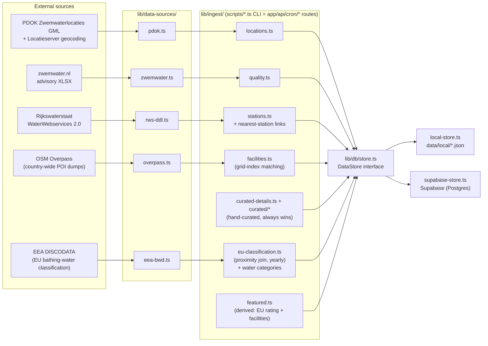
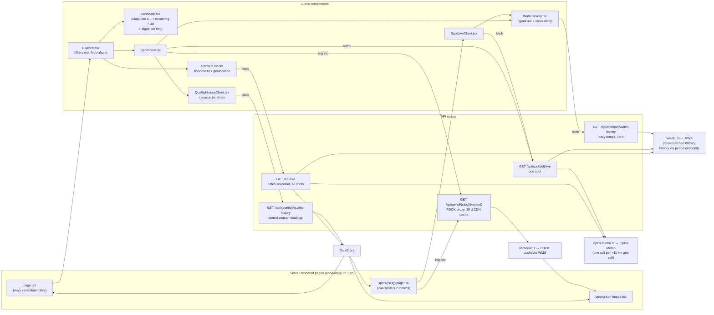

# NL Swim Spot Explorer

Interactive map of all ~744 **official Dutch outdoor swimming locations** —
plus a hand-curated set of **widely-used unofficial spots**, clearly flagged —
with:

- **"Best right now" ranking** — scores every spot on live water temp, weather,
  quality and (client-side) distance to you; powered by `GET /api/live`, one
  CDN-cacheable batch snapshot for all spots
- **Water quality** — official status from zwemwater.nl advisories (+ last-measured
  date), plus a **season timeline** of this year's readings per spot (refreshed
  daily during the bathing season, monthly off-season)
- **Blue-green algae (blauwalg) front and center** — advisory reasons are parsed
  out of the raw zwemwater.nl codes (`lib/quality.ts parseAdvisory`); algae gets
  its own violet badge, a violet map-pin ring and a "hide algae warnings"
  filter, and a distinct caution in the ranking
- **EU bathing-water classification** — the annual excellent/good/sufficient/poor
  rating from the EEA dataset (the blue signs at the water), shown with its year
  next to the advisory badge (`ingest:eu`, yearly cron)
- **⭐ Top rated (Beste zwemwater)** — a data-derived shortlist of ~73 spots:
  EU rating "excellent" + the most facilities, top 5 per province
  (`compute:featured`, monthly cron), plus the hand-picked list in
  `lib/ingest/featured-spots.ts`. Indigo badge + bigger pins, a map toggle, and
  an explainer callout on the spot card saying why it's top-rated
- **Map filters** — city selector (18 major cities from `lib/cities.ts`; shows
  spots within 20 km and flies the camera there), water-type dropdown
  (sea/lake/river/estuary, from the EEA water category), top-rated and
  hide-algae pill toggles
- **Water temperature** — latest reading from the nearest *live* Rijkswaterstaat
  sensor, plus a **14-day sparkline** with a "warmed X°C this week" delta
  (RWS period endpoint, fetched on demand, 6 h cache)
- **Dutch-first, English toggle** — Dutch is served on the unprefixed URLs
  (`/`, `/spots/[slug]`), English under `/en/...`; locale routing in `proxy.ts`,
  dictionaries in `dictionaries/{nl,en}.json`, hreflang/canonical/sitemap
  alternates wired for SEO
- **Weather** — current conditions per exact coordinates (Open-Meteo)
- **Aerial photos** — PDOK Luchtfoto (25 cm orthophoto) hero/thumbnail/OG image
  per spot, generated deterministically from coordinates (`lib/aerial.ts`) and
  served through `/api/aerial/[slug]/[variant]` behind a 30-day CDN cache —
  never through `next/image` (see [Image delivery](#image-delivery))
- **Facilities** — toilets/food/parking auto-detected from OpenStreetMap for all
  spots (`ingest:facilities`); hand-curated data for eight city regions
  (`lib/ingest/curated/`) always wins. Spots
  without curated notes get a localized description generated from structured
  data (`lib/describe.ts`)
- **Unofficial spots** — hand-curated, widely-known swim spots that aren't
  officially designated (`seed:unofficial`, list in
  `lib/ingest/unofficial-spots.ts`); flagged everywhere with an amber pin ring,
  an "Unofficial spot" badge and a swim-at-your-own-risk note, and excluded
  from the zwemwater.nl all-clear (they show "No data / not monitored")
- **SEO pages** — two static pages per spot (`/spots/[slug]` Dutch,
  `/en/spots/[slug]` English), sitemap with language alternates, OG images

Built with Next.js (App Router) + TypeScript, Tailwind, MapLibre GL JS + MapTiler vector tiles (3D-capable map), Supabase, Vercel Cron.

## Quick start (no database needed)

The repo ships with a pre-ingested snapshot in `data/local/`. When Supabase env
vars are absent, the app and all scripts transparently read/write those JSON
files instead. The map does need a (free) [MapTiler API key](https://cloud.maptiler.com/account/keys):

```bash
npm install
echo "NEXT_PUBLIC_MAPTILER_KEY=<your key>" > .env.local
npm run dev        # → http://localhost:3000, fully working
```

## Production setup (Supabase)

1. Create a project at [supabase.com](https://supabase.com) and run **every**
   file in `supabase/migrations/` in numeric order in the SQL editor. They are
   cumulative — skipping one leaves columns the app reads missing.
2. `cp .env.example .env.local` and fill in:
   - `NEXT_PUBLIC_SUPABASE_URL`, `NEXT_PUBLIC_SUPABASE_ANON_KEY`
   - `SUPABASE_SERVICE_ROLE_KEY` (scripts/cron only — never shipped to the client)
   - `CRON_SECRET` (any random string; set the same value in Vercel env vars)
   - `NEXT_PUBLIC_SITE_URL` (production URL, for sitemap/metadata)
   - `NEXT_PUBLIC_MAPTILER_KEY` (map tiles; restrict it to your domain in the
     [MapTiler dashboard](https://cloud.maptiler.com/account/keys) since it ships in the client bundle)
   - `CRON_SEASON_PAUSED` (optional; `1` parks the in-season refreshes over the
     winter — see [Off-season pause](#off-season-pause))
3. Ingest everything:

```bash
npm run ingest:all
```

which runs, in order:

| Script | What it does |
|---|---|
| `ingest:locations` | Pulls the PDOK *Zwemwaterlocaties* INSPIRE dataset (GML), converts polygon centroids EPSG:3035 → WGS84, reverse-geocodes province/municipality via PDOK Locatieserver, upserts `swim_spots` |
| `seed:unofficial` | Hand-curated, widely-used **unofficial** swim spots (`official_status: "unofficial"`) with access notes; not quality-monitored, flagged as swim-at-your-own-risk in the UI. Add new ones in `lib/ingest/unofficial-spots.ts` |
| `seed:stations` | Pulls the RWS WaterWebservices catalog (~1080 stations measuring surface-water temp), probes them in batches and keeps only the ~116 with a reading in the last 7 days, then links every spot to its nearest live station (≤ 25 km) |
| `ingest:quality` | Downloads the zwemwater.nl advisory XLSX, maps active advisories (warning / negative advice / ban) onto spots by normalized name, snapshots a status per spot into `water_quality_readings` |
| `seed:details` | Hand-curated facilities/hours for the Amsterdam, Utrecht, Rotterdam, Den Haag, Eindhoven, Alkmaar, Haarlem and Groningen regions (~83 spots; one seed module per city in `lib/ingest/curated/`) |
| `ingest:facilities` | Downloads toilets/parking/food/lifeguard POIs for all of NL from OSM Overpass (one country-wide dump per category — spatially-scoped queries time out at 744 spots), matches them to spots via a grid index (300–400 m radius), fills only fields the curated seeds left null |
| `ingest:zwemwater-ids` | Scrapes the zwemwater.nl location list (~950 entries) and matches spots by normalized name (84%), storing `zwemwater_id` — powers the per-spot bacteriological measurements chart (`/api/spot/[slug]/measurements`, fetched on demand from zwemwater.nl's detail overlay, 12 h cache). Re-run weekly by the `refresh-locations` cron |
| `ingest:eu` | Pulls the latest-season EU bathing-water classifications + registry coordinates from EEA DISCODATA, joins them to official spots by proximity (0.5 km cap, normalized-name fallback; ~98% matched), stores `eu_bw_id` / `eu_classification` / `eu_classification_year` and the water category (`water_type`: sea/lake/river/transitional) on `swim_spots` |
| `compute:featured` | Re-derives the featured set from data: official spots rated "excellent" (EU) ranked by facility count, top 5 per province, plus the hand-picked list in `lib/ingest/featured-spots.ts` |

## Scheduled refresh (Vercel Cron)

Vercel's Hobby plan allows **two cron jobs per project**, so `vercel.json`
defines a single daily schedule (05:00 UTC) pointing at `/api/cron/daily`, and
that route decides what is due from the date. Per-job schedules live in the
`JOBS` table in `app/api/cron/daily/route.ts`. Jobs run sequentially and a
failure in one does not skip the rest; everything is authorized via the
`CRON_SECRET` bearer token Vercel sends automatically.

- **quality** — daily during the bathing season (May–Oct), monthly (2nd) the
  rest of the year: re-ingests the advisory XLSX; readings are append-only per
  `(spot_id, measured_at, source)`, so this builds the per-spot quality history
  the season timeline renders. Returns `changedSlugs` — the spots whose status
  or advisory reason actually moved — which is what drives revalidation below;
  on a typical in-season day that set is **empty**, because the snapshot
  re-records the same verdict for all ~744 monitored spots
- **locations** — weekly (Mon), and first in the run order because its upsert
  may add spots the later jobs need to see: re-pulls PDOK **and** re-probes
  live stations / re-links nearest stations / re-matches zwemwater.nl ids
- **facilities** — monthly (3rd): re-runs the OSM facilities backfill
- **featured** — monthly (4th, the day after facilities, which it is derived
  from): re-derives the data-driven featured set
- **eu-classification** — yearly (June 20, after the EEA publishes):
  re-ingests the annual EU classification + water categories

### Off-season pause

`quality` and `locations` are the two in-season jobs (daily and weekly) and are
marked `seasonal` in the `JOBS` table. Setting **`CRON_SEASON_PAUSED=1`** on the
Vercel project parks both of them entirely until it is unset — **do that in
May**, or the site's advisories and spot list stay frozen at their October
state. The monthly (`facilities`, `featured`) and yearly (`eu-classification`)
jobs are unaffected and keep running through the winter.

Pausing also stops the Monday `SPOT_PAGES` sweep, since that is emitted by
`quality`'s `revalidates` — which is most of the point: over the winter there is
no new quality data, so the sweep would rewrite ~1,500 pages a week to change an
"as of" date. `/api/cron/daily` reports `seasonPaused` and `parked` so a paused
run is distinguishable from a genuinely idle day.

The per-job `/api/cron/refresh-*` routes are kept for manual triggering
(`curl -H "Authorization: Bearer $CRON_SECRET" …`) — they are no longer
scheduled, and they ignore `CRON_SEASON_PAUSED`, so a one-off mid-winter
refresh does not need the switch flipped. Note that Hobby cron triggers are
approximate (within the hour).

Live data (weather + water temp) is deliberately **not** cron-ingested: the
`/api/spot/[slug]/live` route fetches it on request with a 30-minute cache, and
`/api/live` returns a batch snapshot for all spots at once (RWS stations
batched 60/request; weather fetched per ~11 km grid cell to stay inside
Open-Meteo's burst limits) behind the same 30-minute CDN cache. Water-temp
*history* (`/api/spot/[slug]/water-history`) is likewise fetched on demand from
RWS's period endpoint, aggregated to daily min/avg/max, behind a 6-hour cache;
`/api/spot/[slug]/quality-history` serves the stored season readings with a
1-hour cache.

### Page revalidation (ISR)

Every page route exports `revalidate = false`. There is **no timer**: the cron
is the only thing that refreshes generated pages, via `revalidatePath`. Each
job declares what its data can change, and `revalidates` receives the job's own
result so it can narrow that down.

This matters because one ISR revalidation rewrites ~11 artifacts (`.html`,
`.rsc`, `.meta` and 8 `.segment.rsc` prefetch payloads), and Vercel's Hobby
plan includes 200,000 ISR write units per month. Regenerating all ~1,570
generated pages costs ~17k units, so *what* gets marked stale is a budget
decision:

- **Route patterns** (`/[lang]/spots/[slug]`) invalidate all ~1,500 spot pages
  at once. Used by jobs that genuinely touch everything — `locations` (weekly),
  `facilities` and `featured` (monthly), `eu-classification` (yearly).
- **Concrete paths** (`/nl/spots/foo`, `/en/spots/foo`) are what the daily
  `quality` job emits, for its `changedSlugs` only. Most days it revalidates
  nothing at all.
- **A weekly sweep** on Monday re-renders everything anyway, because the "as
  of" date and the season timeline advance with each snapshot even when the
  status does not — without it those two would drift indefinitely. Monday is
  deliberate: the `locations` job already sweeps that day and the caller
  de-duplicates, so the sweep is free.

Rehearse the change detection against live data before deploying cron changes —
read-only, inserts nothing:

```bash
npx tsx scripts/dry-run-quality-changes.ts
```

`revalidatePath` patterns must be **internal** route paths (`/[lang]/...`), not
the URLs in the address bar: `proxy.ts` rewrites unprefixed Dutch URLs to
`/nl/...`, and `revalidatePath` keys off the route file structure.

### Image delivery

Aerial photos are the only images on the site, and they must never go through
`next/image` optimization. PDOK's WMS bakes `width`/`height` into the request
and returns exactly that JPEG, so Vercel's optimizer would be billed to
re-encode an image the origin already sized correctly — 748 spots × 3 crops ×
2 `srcSet` variants ≈ 4,488 transformations against a 5,000/month free tier.

Instead, `/api/aerial/[slug]/[variant]` proxies PDOK and re-serves the bytes
with a long `Cache-Control` (PDOK sends none at all), and the `<Image>` call
sites pass `unoptimized`. Crops live in `AERIAL_VARIANTS` (`lib/aerial.ts`);
`aerialSrc(slug, variant)` builds the path. Only known slugs and a fixed set of
crops resolve, so the route is not a general-purpose open proxy.

`images.remotePatterns` is deliberately **absent** from `next.config.ts`: with
no pattern configured, any future `<Image src="https://service.pdok.nl/…">`
fails loudly instead of silently re-billing a transformation per spot per size.

## Architecture

Two views: how data gets **into** the store, and how it flows **out** to the
browser at runtime.

### Ingestion pipeline (CLI scripts + Vercel Cron)

Every ingest lives in `lib/ingest/` and is shared by a thin CLI wrapper in
`scripts/` and (where scheduled) a cron route in `app/api/cron/`. All writes go
through the `DataStore` interface, which picks Supabase or local JSON at
runtime based on env vars.



### Runtime request flow

Live data (water temp, weather) is never stored — it's fetched on request with
a 30-minute cache. Aerial imagery is never stored either: `lib/aerial.ts`
builds a deterministic PDOK WMS URL from each spot's coordinates, which
`/api/aerial` fetches and re-serves behind a 30-day CDN cache. The OG image is
the one exception — it embeds the PDOK URL directly, since `ImageResponse`
renders server-side and costs no image transformation.

Locale routing happens in `proxy.ts` (Next 16's middleware convention): Dutch
is an invisible rewrite of unprefixed URLs to `/nl/...`, English is a real
`/en` segment; both render from `app/[lang]/`, with the dictionary threaded
into the client tree via `I18nProvider`.



### Directory map

```text
proxy.ts                    # locale routing: nl unprefixed (rewrite), /en real segment
dictionaries/               # nl.json + en.json (all UI strings, weather codes, labels)
app/
  [lang]/page.tsx           # map home (revalidate=false) → I18nProvider → Explorer
  [lang]/layout.tsx         # <html lang>, header, NL|EN switcher, per-locale metadata
  [lang]/spots/[slug]/      # static page per spot per locale + opengraph-image.tsx
  api/live/route.ts         # batch live snapshot (CDN-cached 30 min)
  api/spot/[id]/live/       # per-spot live data
  api/spot/[id]/water-history/    # daily water temps (14 d) + week delta (6 h cache)
  api/spot/[id]/quality-history/  # stored season readings (1 h cache)
  api/aerial/[slug]/[variant]/    # PDOK aerial proxy (30 d CDN cache, no next/image)
  api/cron/daily            # the one scheduled route; dispatches what's due
                            #   + revalidatePath for the jobs that actually ran
  api/cron/refresh-*        # per-job routes, manual trigger only
components/
  Explorer.tsx              # client state hub: map + ranked list + panel + filters
  SwimMap.tsx  RankedList.tsx  SpotPanel.tsx  SpotLiveClient.tsx
  I18nProvider.tsx  LanguageSwitcher.tsx
  WaterHistory.tsx  TempSparkline.tsx  QualityHistoryClient.tsx  QualityTimeline.tsx
  EuClassBadge.tsx
lib/
  i18n.ts                   # Locale, getDictionary, t(), formatDate, pathFor
  db/store.ts               # DataStore interface → supabase-store | local-store
  data-sources/             # one adapter per external API (incl. eea-bwd.ts)
  ingest/                   # write pipelines (shared by scripts/ and cron)
  aerial.ts                 # PDOK WMS URLs + AERIAL_VARIANTS + aerialSrc()
  score.ts  geo.ts  quality.ts  slug.ts  types.ts  cron-auth.ts
scripts/                    # CLI wrappers: ingest:*, seed:* (npm run)
  dry-run-quality-changes.ts  # read-only: what the cron would revalidate today
  probe-readings-limit.ts     # read-only: PostgREST 1000-row truncation check
data/local/                 # pre-ingested JSON snapshot (no-DB quick start)
supabase/migrations/        # cumulative schema, 0001…N — run all of them, in order
```

## Data sources & credits

| Data | Source |
|---|---|
| Locations | [PDOK — Zwemwaterlocaties (INSPIRE)](https://service.pdok.nl/provincies/zwemwater-provinciaal-rijkswateren/atom/v1_0/index.xml) (CC-BY 4.0) |
| Province/municipality | [PDOK Locatieserver](https://api.pdok.nl/bzk/locatieserver/search/v3_1/reverse) reverse geocoding |
| Water quality | [zwemwater.nl](https://www.zwemwater.nl/data-en-api) published-measures XLSX |
| Water temperature | [Rijkswaterstaat WaterWebservices 2.0](https://rijkswaterstaatdata.nl/waterdata/) (`ddapi20-waterwebservices.rijkswaterstaat.nl`; latest + period history) |
| EU classification | [EEA DISCODATA](https://discodata.eea.europa.eu/) `WISE_BWD` (annual bathing-water status + registry coordinates) |
| Weather | [Open-Meteo](https://open-meteo.com/) (no key) |
| Aerial photos | [PDOK — Luchtfoto Actueel Ortho 25cm](https://www.pdok.nl/introductie/-/article/luchtfoto-pdok) (Beeldmateriaal Nederland, CC-BY 4.0) |
| Map tiles | [MapTiler](https://www.maptiler.com/copyright/) Outdoor v2 vector style (© MapTiler © [OpenStreetMap](https://www.openstreetmap.org/copyright) contributors), rendered with [MapLibre GL JS](https://maplibre.org/) |

Facilities for non-featured spots are auto-detected from OpenStreetMap
(`ingest:facilities`) and labeled as such in the UI; toilets/food/parking are
well-mapped in NL so "not found nearby" is shown as "No", while lifeguard
presence stays "Unknown" without positive evidence. `webcam_url` exists in the
schema but is null everywhere — no genuine public webcams exist at Dutch swim
spots today.

## Notes & follow-ups (from the build plan)

- **BIJ12 WFS access**: email communicatie@bij12.nl about direct WMS/WFS access to
  the zwemwater register — would replace the XLSX ingestion and could backfill
  facilities nationally. Parallel track, not a blocker.
- The classic RWS API (`waterwebservices.rijkswaterstaat.nl`) was retired April
  2026; this project already uses the successor ("Wadar") API.
- Spots >25 km from a live sensor show "—" for water temperature instead of a
  misleading stale grab-sample value; readings older than 72 h are discarded.
- **EEA data lag**: DISCODATA's `[latest]` schema trails the annual report by a
  few months (season 2024 as of July 2026 even though the 2025 report PDF is
  out). `ingest:eu` always takes `MAX(season)`, and the UI shows the year on
  the badge, so stale data is self-describing.
- The quality **season timeline** renders only once a spot has ≥2 stored
  readings; history accumulates one snapshot per `refresh-quality` cron run
  (daily in-season, monthly off-season), so first seasons look sparse by
  design.
- **Never use an unbounded `select()` on `water_quality_readings`.** PostgREST
  silently caps at 1,000 rows and reports no error. `getSpotsWithData()` did
  exactly that, and because an all-clear reading is dated *today* while an
  advisory keeps the date it *started*, the truncated window held only the last
  ~1.3 days of all-clears — so every spot under active advisory came back as
  `latest_quality: null` and rendered as "Geen gegevens" on all listing pages
  (87 spots, including a swim ban). Fixed by paginating with `.range()`;
  `scripts/probe-readings-limit.ts` reproduces the failure. Spot pages were
  never affected — `getSpotBySlug` scopes its own query with `.limit(1)`.
- **Follow-up — stop inserting no-op readings.** The in-season `quality` job
  appends ~744 rows per day even when nothing changed. That is what forces the
  weekly ISR sweep to exist (the "as of" date advances daily) and what makes
  the pagination above cost one extra round-trip per 1,000 rows on every
  listing render — 6 today, growing indefinitely. Inserting only on an actual
  status change fixes both: `measured_at` becomes "since when this status
  holds", and the table stops growing. Needs one adjustment to
  `QualityTimeline`, which bails at `readings.length < 2` and would otherwise
  hide the timeline for always-good spots.
