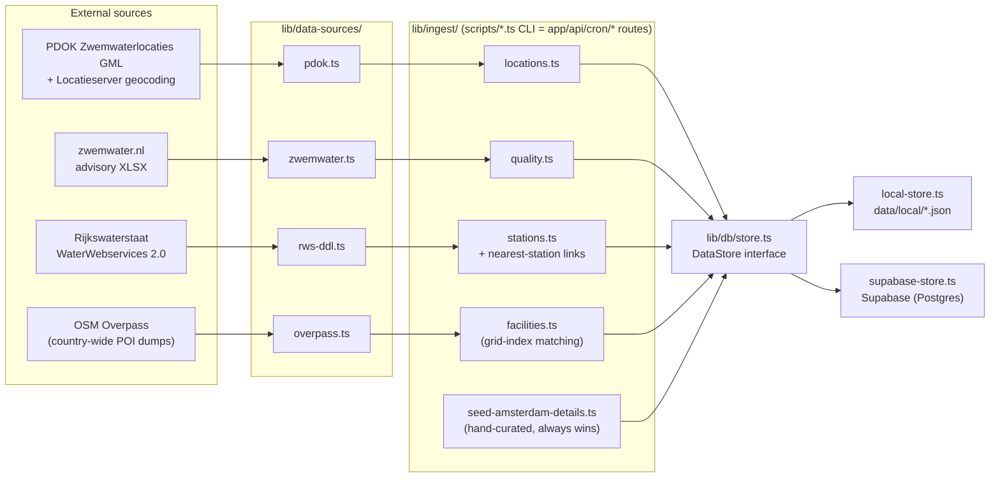
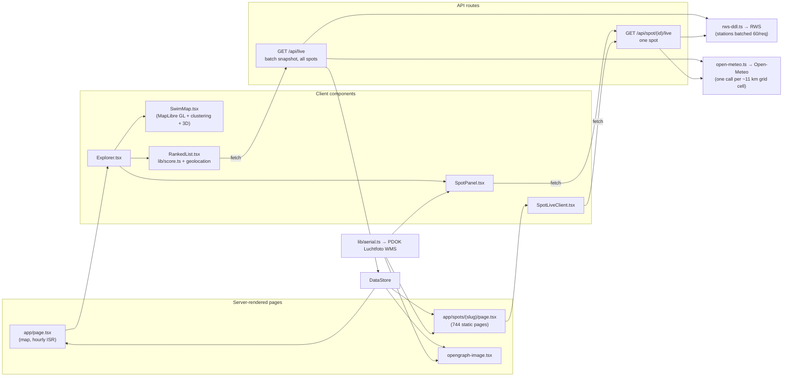

# NL Swim Spot Explorer

Interactive map of all ~744 **official Dutch outdoor swimming locations** —
plus a hand-curated set of **widely-used unofficial spots**, clearly flagged —
with:

- **"Best right now" ranking** — scores every spot on live water temp, weather,
  quality and (client-side) distance to you; powered by `GET /api/live`, one
  CDN-cacheable batch snapshot for all spots
- **Water quality** — official status from zwemwater.nl advisories (+ last-measured date)
- **Water temperature** — latest reading from the nearest *live* Rijkswaterstaat sensor
- **Weather** — current conditions per exact coordinates (Open-Meteo)
- **Aerial photos** — PDOK Luchtfoto (25 cm orthophoto) hero/thumbnail/OG image
  per spot, generated deterministically from coordinates (`lib/aerial.ts`)
- **Facilities** — toilets/food/parking auto-detected from OpenStreetMap for all
  spots (`ingest:facilities`), hand-curated data for the featured Amsterdam-area
  spots always wins
- **Unofficial spots** — hand-curated, widely-known swim spots that aren't
  officially designated (`seed:unofficial`, list in
  `lib/ingest/unofficial-spots.ts`); flagged everywhere with an amber pin ring,
  an "Unofficial spot" badge and a swim-at-your-own-risk note, and excluded
  from the zwemwater.nl all-clear (they show "No data / not monitored")
- **SEO pages** — one static page per spot (`/spots/[slug]`), sitemap, OG images

Built with Next.js (App Router) + TypeScript, Tailwind, MapLibre GL JS + MapTiler vector tiles (3D-capable map), Supabase, Vercel Cron.

## Quick start (no database needed)

The repo ships with a pre-ingested snapshot in `data/local/`. When Supabase env
vars are absent, the app and all scripts transparently read/write those JSON
files instead. The map does need a (free) [MapTiler API key](https://cloud.maptiler.com/account/keys):

```bash
npm install
echo "NEXT_PUBLIC_MAPTILER_KEY=<your key>" > .env.local
npm run dev        # → http://localhost:3000, fully working
```

## Production setup (Supabase)

1. Create a project at [supabase.com](https://supabase.com) and run
   `supabase/migrations/0001_init.sql` in the SQL editor.
2. `cp .env.example .env.local` and fill in:
   - `NEXT_PUBLIC_SUPABASE_URL`, `NEXT_PUBLIC_SUPABASE_ANON_KEY`
   - `SUPABASE_SERVICE_ROLE_KEY` (scripts/cron only — never shipped to the client)
   - `CRON_SECRET` (any random string; set the same value in Vercel env vars)
   - `NEXT_PUBLIC_SITE_URL` (production URL, for sitemap/metadata)
   - `NEXT_PUBLIC_MAPTILER_KEY` (map tiles; restrict it to your domain in the
     [MapTiler dashboard](https://cloud.maptiler.com/account/keys) since it ships in the client bundle)
3. Ingest everything:

```bash
npm run ingest:all
```

which runs, in order:

| Script | What it does |
|---|---|
| `ingest:locations` | Pulls the PDOK *Zwemwaterlocaties* INSPIRE dataset (GML), converts polygon centroids EPSG:3035 → WGS84, reverse-geocodes province/municipality via PDOK Locatieserver, upserts `swim_spots` |
| `seed:unofficial` | Hand-curated, widely-used **unofficial** swim spots (`official_status: "unofficial"`) with access notes; not quality-monitored, flagged as swim-at-your-own-risk in the UI. Add new ones in `lib/ingest/unofficial-spots.ts` |
| `seed:stations` | Pulls the RWS WaterWebservices catalog (~1080 stations measuring surface-water temp), probes them in batches and keeps only the ~116 with a reading in the last 7 days, then links every spot to its nearest live station (≤ 25 km) |
| `ingest:quality` | Downloads the monthly zwemwater.nl advisory XLSX, maps active advisories (warning / negative advice / ban) onto spots by normalized name, snapshots a status per spot into `water_quality_readings` |
| `seed:amsterdam` | Hand-curated facilities/hours for the 15 featured Amsterdam-area spots (Gaasperplas, IJburg, Nieuwe Meer, Diemerpark, Marineterrein, Het Twiske) |
| `ingest:facilities` | Downloads toilets/parking/food/lifeguard POIs for all of NL from OSM Overpass (one country-wide dump per category — spatially-scoped queries time out at 744 spots), matches them to spots via a grid index (300–400 m radius), fills only fields the curated seeds left null |

## Scheduled refresh (Vercel Cron)

`vercel.json` defines three jobs (all authorized via the `CRON_SECRET` bearer
token Vercel sends automatically):

- `/api/cron/refresh-quality` — monthly (2nd, 06:00 UTC): re-ingests the advisory XLSX
- `/api/cron/refresh-locations` — weekly (Mon, 05:00 UTC): re-pulls PDOK **and**
  re-probes live stations / re-links nearest stations
- `/api/cron/refresh-facilities` — monthly (3rd, 06:00 UTC): re-runs the OSM
  facilities backfill

Live data (weather + water temp) is deliberately **not** cron-ingested: the
`/api/spot/[slug]/live` route fetches it on request with a 30-minute cache, and
`/api/live` returns a batch snapshot for all spots at once (RWS stations
batched 60/request; weather fetched per ~11 km grid cell to stay inside
Open-Meteo's burst limits) behind the same 30-minute CDN cache.

## Architecture

Two views: how data gets **into** the store, and how it flows **out** to the
browser at runtime.

### Ingestion pipeline (CLI scripts + Vercel Cron)

Every ingest lives in `lib/ingest/` and is shared by a thin CLI wrapper in
`scripts/` and (where scheduled) a cron route in `app/api/cron/`. All writes go
through the `DataStore` interface, which picks Supabase or local JSON at
runtime based on env vars.



### Runtime request flow

Live data (water temp, weather) is never stored — it's fetched on request with
a 30-minute cache. Aerial imagery is never stored either: `lib/aerial.ts`
builds a deterministic PDOK WMS URL from each spot's coordinates.



### Directory map

```text
app/
  page.tsx                  # map home (ISR 1h) → Explorer
  spots/[slug]/page.tsx     # static page per spot + opengraph-image.tsx
  api/live/route.ts         # batch live snapshot (CDN-cached 30 min)
  api/spot/[id]/live/       # per-spot live data
  api/cron/refresh-*        # quality / locations / facilities (CRON_SECRET-guarded)
components/
  Explorer.tsx              # client state hub: map + ranked list + panel
  SwimMap.tsx  RankedList.tsx  SpotPanel.tsx  SpotLiveClient.tsx
lib/
  db/store.ts               # DataStore interface → supabase-store | local-store
  data-sources/             # one adapter per external API
  ingest/                   # write pipelines (shared by scripts/ and cron)
  aerial.ts  score.ts  geo.ts  quality.ts  slug.ts  types.ts  cron-auth.ts
scripts/                    # CLI wrappers: ingest:*, seed:* (npm run)
data/local/                 # pre-ingested JSON snapshot (no-DB quick start)
supabase/migrations/        # schema (0001 init, 0002 facilities)
```

## Data sources & credits

| Data | Source |
|---|---|
| Locations | [PDOK — Zwemwaterlocaties (INSPIRE)](https://service.pdok.nl/provincies/zwemwater-provinciaal-rijkswateren/atom/v1_0/index.xml) (CC-BY 4.0) |
| Province/municipality | [PDOK Locatieserver](https://api.pdok.nl/bzk/locatieserver/search/v3_1/reverse) reverse geocoding |
| Water quality | [zwemwater.nl](https://www.zwemwater.nl/data-en-api) monthly published-measures XLSX |
| Water temperature | [Rijkswaterstaat WaterWebservices 2.0](https://rijkswaterstaatdata.nl/waterdata/) (`ddapi20-waterwebservices.rijkswaterstaat.nl`) |
| Weather | [Open-Meteo](https://open-meteo.com/) (no key) |
| Aerial photos | [PDOK — Luchtfoto Actueel Ortho 25cm](https://www.pdok.nl/introductie/-/article/luchtfoto-pdok) (Beeldmateriaal Nederland, CC-BY 4.0) |
| Map tiles | [MapTiler](https://www.maptiler.com/copyright/) Outdoor v2 vector style (© MapTiler © [OpenStreetMap](https://www.openstreetmap.org/copyright) contributors), rendered with [MapLibre GL JS](https://maplibre.org/) |

Facilities for non-featured spots are auto-detected from OpenStreetMap
(`ingest:facilities`) and labeled as such in the UI; toilets/food/parking are
well-mapped in NL so "not found nearby" is shown as "No", while lifeguard
presence stays "Unknown" without positive evidence. `webcam_url` exists in the
schema but is null everywhere — no genuine public webcams exist at Dutch swim
spots today.

## Notes & follow-ups (from the build plan)

- **BIJ12 WFS access**: email communicatie@bij12.nl about direct WMS/WFS access to
  the zwemwater register — would replace the XLSX ingestion and could backfill
  facilities nationally. Parallel track, not a blocker.
- The classic RWS API (`waterwebservices.rijkswaterstaat.nl`) was retired April
  2026; this project already uses the successor ("Wadar") API.
- Spots >25 km from a live sensor show "—" for water temperature instead of a
  misleading stale grab-sample value; readings older than 72 h are discarded.
